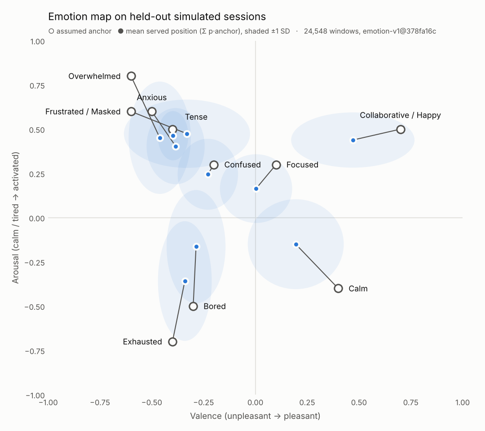

# Model card: Valence M2 (served) and its baselines

> **Every accuracy result in this card comes from simulated data.** Simulator v2 generated it under the behavioral
> assumptions in §3 and [DATASET.md](DATASET.md). The results test the architecture. They say nothing about
> accuracy on real people. The real-data checks (§5) are unlabeled replays of one person at one desk, and the
> negative control is in-sample. Claim wording:
> *"Under explicit, published behavioral assumptions, a temporal context model beats a face snapshot; in-the-wild
> validation is future work."*

Sources: `reports/metrics.json` (results, generated 2026-10-18 15:38:46, M3 merged in), `reports/m3_metrics.json`
(M3), `artifacts/model_meta.json` (training run), `artifacts/legacy/model_meta.json` (the previous served model,
kept for the venue-shift comparison and as a rollback) and the code cited in each row. Regenerate with
`make train`, `python -m valence.models.temporal`, then `make eval`. A new `artifacts/m2.txt` means a new version
id and new numbers.

## 1. Model details

| Item | Value | Source |
|---|---|---|
| Served model | **M2** = context history + face history. M0 (face snapshot) runs every tick as a shadow model | `valence/models/served.py` |
| Algorithm | LightGBM gradient-boosted trees, `objective=multiclass`, softmax with a fitted temperature | `valence/models/train_ladder.py` |
| Version id | `m2_lgbm@<sha8>`: the first 8 hex characters of the SHA-256 of `artifacts/m2.txt`. Exposed as `served` in `GET /api/models`, as `model` in `/api/health` and as `feature_version` in `hello`. Current: **`m2_lgbm@8a78efc7`**. The previous served model, `m2_lgbm@85874e97` (absolute dB/lux, no venue variation in training), is kept in `artifacts/legacy/`; `VALENCE_ARTIFACTS_DIR=artifacts/legacy` serves it | `served.py` |
| Trained | `2026-10-18 15:08:44` (`trained_at`), on the simulator refit to live capture run 1 (commit `e0ad762`) with a random venue per session (`bbd46a4`, §3), with modality dropout (§3) | `artifacts/model_meta.json` |
| Training run | simulator v2, 300 sessions, seed 7, `noise_scale` 1.0 (untuned), state set `core`; M2-family face models get modality-dropout copies | `model_meta.json`, `make train`, `train_ladder.py` `face_dropout` |
| Classes | Focused, Frustrated_Masked, Exhausted, Collaborative_Happy | `valence/contracts.py` `CORE_STATES` |
| Input | 123 features computed from one person's rolling window plus the room's window (5 s ticks, up to 180 ticks = 15 min); M2 uses 101 of them. No served model sees an absolute dB or lux level: room level enters relative to the venue baseline (`TickRecord.room_db_base` / `room_lux_base`, `POST /api/room/baseline`). Served models read their feature lists from `model_meta.json` `feature_sets` | `valence/features/compute.py`, `served.py` |
| Output | calibrated probabilities, label, TreeSHAP attributions grouped into 4 layers, face-only reading, mask-override flag | `served.py`, `predictor.py` |
| Hyperparameters | learning rate 0.05, 31 leaves, `min_data_in_leaf` 100, feature and bagging fraction 0.8, at most 800 rounds, early stop after 50, class weights n/(k·count), seed 7 | `train_ladder.py` `PARAMS` |
| Rounds / temperature | M2 261 rounds, T = 0.934. M0 102 rounds, T = 0.882 | `model_meta.json` `summary` |
| Calibration | one temperature per model, fitted by NLL on the calibration half (bounds 0.25–8) | `fit_temperature` |
| Runtime | `predict` and `pred_contrib` with `num_threads=1`, because the torch + LightGBM libomp combination segfaults otherwise | `served.py`, [BENCHMARKS.md](BENCHMARKS.md) |
| License | MIT | `LICENSE` |

**Features (123, order in `model_meta.json` `feature_names`).** Missing values stay NaN, and LightGBM handles
them natively.

| Group | Features | Count | Explanation layer |
|---|---|---|---|
| Room levels: `db`, `lux` | `_now`; `_mean/_std/_slope/_max` over 1, 5 and 15 min; `_ewm_1m/_5m`; `_d1m15m` (1-min mean minus 15-min mean); `_rel_15m` (now minus the 15-min median). `_slope_1m` and `_std_1m` are computed but used by no model in the ladder (`NOISY_LIVE`: dominated by live transients). The 18 absolute levels (`_now`, `_mean_*`, `_max_*`, `_ewm_*`; `ABS_ROOM`) are computed and quoted in explanations, but only the M2-abs ablation uses them | 2 × 17 | Ambient Physics |
| Room relative to the venue baseline (`ROOM_REL`) | `db_room_now`, `db_room_mean_1m/_5m/_15m`, `db_room_max_5m`, `db_room_ewm_5m`: dB above `room_db_base`; `lux_room_now`, `lux_room_mean_5m/_15m`: log2(lux / `room_lux_base`). A loud hall is then this room's normal, not "loud" | 9 | Ambient Physics |
| Person levels: `motion`, `slump`, `hih` | same 17 statistics per channel | 3 × 17 | Somatic & Social |
| Events: `fist` (person), `laugh`, `compl` (room) | `_cnt_now`, `_cnt_1m/_5m/_15m`, `_since_s` (capped at 900 s) | 3 × 5 | Somatic & Social |
| Social, time, fill | `withdraw_now`, `withdraw_frac_5m`, `n_people`; `hours_since_break`, `tod_sin`, `tod_cos`; `fill_ratio` | 7 | S&S; Time Dynamics; `fill_ratio` is never narrated |
| Face | `face_now`, `face_visible_now`, `face_mean_1m/_5m/_15m`, `face_std_5m`, `face_visible_frac_5m` | 7 | Facial Surface |

**Model ladder** (feature sets in `compute.py` `FEATURE_SETS`):

| Model | Inputs | # features | Role |
|---|---|---|---|
| M0 | `face_now`, `face_visible_now` | 2 | face-snapshot baseline; served as the shadow model |
| M0t | the 7 face features | 7 | face history |
| M1 | 9 context `_now` values (room level as `db_room_now`, `lux_room_now`), `n_people`, `hours_since_break`, `tod_sin`, `tod_cos` | 13 | context snapshot |
| M2-noface | M2 minus the 7 face features | 94 | ablation: how much the face adds |
| M2-abs † | the pre-baseline set: the 18 absolute room levels instead of the 9 room-relative ones (all 114 non-relative features minus the 4 `NOISY_LIVE`), trained on the same venue-randomized corpus | 110 | ablation: absolute vs room-relative levels (venue shift, §5) |
| M2-notime † | M2 minus `hours_since_break`, `tod_sin`, `tod_cos` | 98 | ablation: operator-settable clock |
| **M2** † | all 123 minus the 4 `NOISY_LIVE` and the 18 absolute room levels | 101 | **served** |
| M3 | GRU(64) + additive attention over 15 raw channels × 180 ticks; the room channels are `db_room` = `ambient_db` − `room_db_base` and `lux_room` = log2(`light_lux` / `room_lux_base`) | — | benchmark only (`valence/models/temporal.py`); §5 |

† Trained with modality dropout (§3): the M2-family models whose features include the face block. M0, M0t, M1,
M2-noface and M3 are trained without it.

**Serving path per tick.** (1) Compute the features, room level relative to the venue baseline carried on the
`TickRecord` (captured on arrival or automatic, ARCHITECTURE §6.1); the absolute levels are kept for the driver
text only. (2) Clip each feature to the training p1–p99
(`artifacts/clip_bounds.json`); list as `data_quality.ood_features` only the features outside their OOD band
(physical domain for bounded features, never for clock features, 50% of the training range beyond p1/p99 for
db/lux/motion; ARCHITECTURE §7.5). (3) Compute softmax(z/T). If more than 3 features are OOD, use
p ← 0.7·p + 0.3/k. (4) Run M0 when `face_now` is not NaN.
(5) Compute TreeSHAP for the argmax class; a room-relative driver's text leads with the absolute level (§6).
(6) Smooth with `PersonSmoother`: an EMA (α 0.5) feeds the *label* only,
and a new label needs 2 consecutive ticks. The displayed confidence is the calibrated, unsmoothed probability of the
shown label, documented as "sim-calibrated" (`contracts.py`). `warming_up` is set for the first 60 s of a window,
and the override is blocked for the first 120 s.

**6-state variant (P1: + Overwhelmed, Tense).** `artifacts/all/` (`m2_lgbm@3be2ee03`, `trained_at` 2026-10-18
15:12:14, on the refit simulator with venue variation and modality dropout, same 101-feature room-relative M2,
254 rounds, T = 0.942). Frustrated_Masked becomes mask-only (`mask_p` 0.92) and Tense takes unmasked frustration.
**Not evaluated** with `evaluate.py` and not negative-controlled; the trainer's own mixed-length test macro-F1
(`artifacts/all/model_meta.json` `summary`, simulated) is M0 0.4543, M2-noface 0.5659, M2 0.7671 (the previous
`4a4d8135`: 0.4614, 0.5732, 0.7682). The `overwhelmed` and `tense` scenarios pass `tests/test_scenarios.py` with it.
Serve with `VALENCE_STATE_SET=all VALENCE_ARTIFACTS_DIR=artifacts/all`.

## 2. Intended use

| | |
|---|---|
| **Intended** | A research prototype for **consented self-monitoring and personal wellbeing outside workplace and education settings**. It also demonstrates explainable, on-device, features-only state estimation in the hackathon demo, on the builder and volunteers who agree at the table ([PRD.md](PRD.md) §1.4). |
| **Users** | The builder, and judges watching the demo. Replay scenarios show `source = replay`. |
| **Regulatory position** | EU AI Act Art. 5(1)(f) prohibits AI systems that infer the emotions of natural persons **in the workplace and in education institutions**. Only medical and safety reasons are exempt, and **consent does not lift the prohibition**. Outside those settings, emotion recognition is high-risk (Annex III 1(c)) and carries a duty to inform people (Art. 50(3)). Room-only mode (`VALENCE_ROOM_ONLY=1` or `POST /api/mode`; a `--room-only` CLI flag is not built) is the configuration to start from in any compliance review. Perception still runs per person in it, and it does not make workplace or classroom use lawful. |

| Out of scope (do not use for) | Why |
|---|---|
| Emotion recognition in workplaces or schools: monitoring, proctoring, productivity or engagement scoring | Prohibited by Art. 5(1)(f) regardless of consent; also a PRD non-goal |
| Hiring, grading, performance review, discipline, or any decision about a person | Trained only on simulated data and never validated on people; the labels are not ground truth |
| Surveillance, identity or face recognition, tracking people across sessions | Non-goal. There is no identity embedding, ids are ephemeral, and baselines are forgotten when an id is released |
| Clinical, diagnostic or mental-health screening | The states are not diagnoses, and nothing here is clinically validated |
| Inferring demographics or appearance | Non-goal; the narrator validator rejects such language |
| Attributing speech or laughter to one person | Audio is a room-scope signal (§7) |

## 3. Training data

Simulator v2 (`valence/sim/generator.py`): sessions of 60–120 min at 5 s ticks, one room, 1–3 people (p 0.4 / 0.4 /
0.2). Each person has a hidden semi-Markov state with Gamma(shape 3, mean `dwell_min`) dwell times (2-min floor, no
self-transitions). The next state is weighted by `max(0.05, 1 + fatigue_affinity·f(h)) × group/solo affinity`, with
`f(h) = 1 / (1 + exp(−(h − 3) / 0.5))` and h = hours since break. Room dB and light lag the occupants' targets, behavior
lags each person's own state, and events are Poisson counts per tick. Each tick also has a room row (`person_id 0`).
Full spec and scenarios: **[DATASET.md](DATASET.md)**. Motion, face and dB/lux noise scales were refit in `e0ad762`
to live capture run 1 (one person at the demo Mac; live-vs-sim comparison in `reports/capture_vs_sim.json`).

**Venue** (`bbd46a4`). Each session draws a hall level U(40, 75) dB, independent of every state, and power-sums it
with the team's own state-driven level: `ambient = power_sum(venue, room_db) + mic offset + drift + noise`. It also
draws the arrival baseline an operator would capture: `room_db_base = power_sum(venue, 48 dB neutral occupant) +
mic offset + N(0, 1.5 dB)` and `room_lux_base = session lux × exp(N(0, 0.08))`. A loud hall alone is therefore never
evidence of a state; loudness above the room's own baseline is. The venue and baseline draws use their own random
stream (crc32 of the session id), so scripted scenarios are otherwise unchanged; scenarios keep a quiet room unless
their YAML sets `venue_db` (`loud_venue`: 72 dB).

**Per-state behavioral parameters** (`valence/sim/params.py` `STATE_PARAMS`; P1 states only with `state_set=all`):

| Parameter | Focused | Frustrated_Masked | Exhausted | Collaborative_Happy | Overwhelmed (P1) | Tense (P1) |
|---|---|---|---|---|---|---|
| `face_mu`, episode-mean valence (0 = personal neutral) | 0.00 | −0.12 | −0.04 | +0.50 | −0.20 | −0.35 |
| `mask_p`, probability of a forced smile (`mask_mu` +0.45) | 0 | 0.70; 0.92 when Tense is in the set (`params_for`) | 0 | 0 | 0 | 0 |
| `db_target`, dB SPL (calibrated mic) | 48 | 66 | 45 | 63 | 66 | 70 |
| `lux_mult`, × session light baseline | 1.00 | 0.85 | 0.65 | 1.15 | 0.85 | 0.95 |
| `fist_rate`, onsets/min (person) | 0 | 0.8 | 0 | 0 | 0.2 | 0.8 |
| `laugh_rate`, onsets/min into the room * | 0.03 | 0.10 | 0.02 | 0.50 | 0.02 | 0.05 |
| `compl_rate`, compliments/min into the room * | 0.02 | 0.02 | 0.01 | 0.20 | 0.01 | 0.01 |
| `slump_p`, share of time slumped * | 0.05 | 0.30 | 0.70 | 0.03 | 0.60 | 0.20 |
| `hih_p`, share of time head in hands * | 0.08 | 0.15 | 0.35 | 0.05 (+0.35 on laughter ticks) | 0.70 | 0.08 |
| `motion`, shoulder-widths/s (live typing p50 0.027) | 0.03 | 0.05 | 0.015 | 0.06 | 0.03 | 0.09 |
| `face_hidden_extra` | 0 | 0 | 0 | 0 | 0.55 → hidden share drawn U(0.4, 0.7) per episode | 0 |
| `dwell_min`, mean episode length (min) | 9 | 6 | 8 | 6 | 5 | 5 |
| `fatigue_affinity` | −0.6 | +1.0 | +2.0 | −0.5 | +1.5 | +1.0 |
| `group_affinity` / `solo_affinity` | 1.0 / 1.0 | 1.0 / 1.0 | 1.0 / 1.0 | 1.8 / 0.4 | 1.0 / 1.0 | 1.5 / 0.6 |
| Break-rate multiplier (`generator.py`) | ×1 | ×1 | ×2 | ×1 | ×2 | ×1 |

\* Checked in part against capture runs 2–3, not refit (§5, `reports/capture_vs_sim.json`): slumping is
detected, but a held slump moves far more live than the simulated Exhausted state (a perception artifact, §7);
laughter and compliments are detected at the desk. Head-in-hands is still unchecked.

**Session nuisance** (`params.py` `Nuisance`; ×ns marks terms that scale with `noise_scale`, which is 1.0 here):

| Parameter | Value | ×ns |
|---|---|---|
| `mic_offset_db` | U(−12, +12) dB per session | |
| dB jitter / drift | σ 1.2 dB per tick; AR(1) drift (×0.95 per tick, σ 0.5 dB); p90 = level + 1.5 + abs(N(0, 1)); +2 dB per laughter onset (at most 2) | ✓ |
| Sound transients | 0.3 per min, +4 to +12 dB (30%: −0.5× that) for 2–8 ticks, state-independent | |
| Venue (`venue_db_range`) | U(40, 75) dB per session, state-independent, power-summed with the team's level; scenarios: none unless `venue_db` is set | |
| Arrival baseline (`neutral_db`, `baseline_db_noise`, `baseline_lux_noise`) | dB: power_sum(venue, 48) + mic offset + N(0, 1.5); lux: session lux (×0.85 for a night start) × exp(N(0, 0.08)); own random stream per session | ✓ |
| Lux | log-uniform 100–800 lux per session; ×0.85 from 22:00 to 06:00; lognormal tick jitter σ 0.015; AR(1) log drift (×0.98, σ 0.01) | jitter, drift ✓ |
| Light transients | 0.5 per min, ×U(0.75, 1.3) for 2–12 ticks (auto-exposure), state-independent | |
| `face_hidden_range` | session share U(0, 0.30), + 0.3 × head-in-hands fraction, cap 0.98 (Overwhelmed: the per-episode share instead) | |
| `face_episode_sd` / `face_tick_sd` | 0.12 / 0.03; readable share of a tick's frames U(0.85, 1.0) | tick ✓ |
| `low_light_lux` | 200: below it, face σ gains + 0.35 × (200 − lux)/200 | |
| `dropout` | 0.02 per tick, per modality (audio per room, video per person) | |
| `room_tau_min` / `person_tau_min` | U(2, 4) / U(1, 2) min lag | ✓ |
| Motion | log-AR(1) toward the state mean (pull 0.25 per tick, innovation σ 0.18); ×0.7 while slumped; still phases in every state (share 0.4, switch 0.06, ×0.5 motion) | innovation ✓ |
| Slump value | slumped: U(0.7, 1.0) of the tick; otherwise 0, or U(0, 0.1) on 15% of ticks (`generator.py`) | |
| Fist bursts | multiplier alternates 1.7 / 0.3, switch probability 0.1 per tick (mean ×1.0) (`generator.py`) | |
| `break_per_min` / `break_len_min` | 1/120 per min / U(10, 20) min; after a break: Focused alone, or Focused / Collaborative_Happy 50/50 with ≥ 2 people | |
| `session_min`, `start_hour`, `start_hours_since_break` | U(60, 120) min, U(9, 23) h, U(0, 5) h | |
| Withdrawal (derived, not a parameter) | slump ≥ 0.6 of the tick and motion ≤ 0.02 sw/s; the live aggregator uses the same rule (`valence/features/spec.py`) | |

**Detector false positives (`params.py` `FP`).** Capture run 1 measured 0.0 fist onsets/min and 0% slump during
3 min of typing, and 0 false onsets around 15 cued clenches ([BENCHMARKS.md](BENCHMARKS.md)); small non-zero rates
are kept so one event is never certain. Capture run 3 counted 0 laughter or compliment events during its quiet
baseline ([BENCHMARKS.md](BENCHMARKS.md)); the rates below were not changed.

| `fist_per_min` | `slump_share` | `laugh_per_min` (room) | `compl_per_min` (room) |
|---|---|---|---|
| 0.02 | 0.02 | 0.02 | 0.01 |

**Training examples** (`valence/features/build_dataset.py`). One window ends every 6 ticks per person, with a random
length of 1–180 ticks. The room window is the full 180 ticks 70% of the time and otherwise matches the person
window. The label is the person's `true_state` at the window's last tick. Splits are by session, from a seeded
permutation (seed 7): 70% train, 7.5% early stopping, 7.5% calibration, 15% test.

**Modality dropout** (`valence/models/train_ladder.py` `face_dropout`, seed 7; only the † models above). Without
it, a context + face model rarely sees a hidden or noisy face and leans on the face. The training split gets two
sets of extra copies of its own windows, with labels kept:

| Copies | Share of training windows | Change to the face block |
|---|---|---|
| Face hidden | 30% | `face_now`, `face_mean_1m/_5m/_15m`, `face_std_5m` → NaN; `face_visible_now`, `face_visible_frac_5m` → 0 |
| Degraded, as in low light | 20% | `face_now` and the three face means + N(0, 0.25), clipped to [−1, 1]; `face_std_5m` + 0.2; both visibility features × one U(0.3, 0.8) draw per copy |

Class weights are computed on the augmented set. Early-stopping, calibration and test windows are never augmented.

## 4. Evaluation data and protocol (`valence/eval/evaluate.py`)

| Aspect | Protocol |
|---|---|
| Test set | 45 held-out simulator sessions, rebuilt from the same seed and split. They are never used for training, early stopping or calibration. Scenarios are never part of any split. |
| Headline set | Windows every 3 ticks with up to 15 min of history (`fixed_len=180`; shorter only where the person's data starts later). Reports macro-F1, balanced accuracy, per-class recall, episode age and calibration. |
| History truncation | Windows every 6 ticks, with the person and room windows both cut to exactly 1 / 12 / 24 / 60 / 120 / 180 ticks (0 / 1 / 2 / 5 / 10 / 15 min). Windows with less history are dropped. |
| Bootstrap CIs | 200 resamples of test sessions with replacement; 2.5th–97.5th percentile of macro-F1. Computed only for the history curve. |
| Focused misread as negative | Share of true-Focused windows predicted Frustrated_Masked or Exhausted (the "Focused paradox") |
| Episode age | Accuracy by seconds since the person entered the current true state |
| Calibration | ECE over 10 equal-width bins of max probability, before (T = 1) and after temperature scaling |
| Robustness | Degrades **only the face channel** at tick level; lux and context are untouched. Face dropout hides an extra share p of person-ticks. "Low light" adds face noise σ and an extra hidden share: relative light 0.5 → 0.15 / 0.10, 0.25 → 0.30 / 0.25, 0.1 → 0.45 / 0.45. |
| Venue shift | The test sessions with a constant hall level of 60, 70 or 75 dB power-summed into `ambient_db`, `db_p90` and the arrival baseline `room_db_base` (`add_venue`); windows every 6 ticks with the full 15 min. Reports Focused misread as negative and macro-F1 for M2, M2-abs and the previous served M2 (`artifacts/legacy`, `85874e97`) |
| Legacy mock | The original generator, 2,000 rows: train on the first 1,400 rows, test accuracy on the other 600, LightGBM 100 rounds |
| Negative control (real data) | `valence/eval/negative_control.py`: replay a features-only typing capture through the served model; pass if Frustrated_Masked/Tense ≤ 20% of non-warm-up ticks |
| **Not done** | The `noise_scale` sensitivity sweep (×0.5 / ×1.5; `tune_difficulty.py` not built), labeled live or in-the-wild data, a negative-control capture from another person or room, the acted set, self-report labels |

## 5. Metrics (simulated data, `reports/metrics.json`)

These numbers evaluate the served artifact `m2_lgbm@8a78efc7` (`calibration_m2.temperature` 0.934 matches
`model_meta.json`). The eight figures in `reports/figs/` were regenerated with this `metrics.json` and committed
with it in `bbd46a4` (`m3_attention.png` comes from the M3 run).

**Ladder, headline set** (45 test sessions, up to 15 min of history; values exactly as in `metrics.json`):

| Model | Macro-F1 | Balanced acc. | Recall Focused | Recall Frustrated_Masked | Recall Exhausted | Recall Collab./Happy | Focused misread as negative |
|---|---|---|---|---|---|---|---|
| M0 | 0.4224 | 0.4442 | 0.4282 | **0.1125** | 0.6009 | 0.6350 | **0.5632** |
| M0t | 0.4898 | 0.5171 | 0.4896 | 0.1810 | 0.6118 | 0.7860 | 0.5008 |
| M1 | 0.5832 | 0.5846 | 0.5778 | 0.4778 | 0.7224 | 0.5604 | 0.2440 |
| M2-noface | 0.6766 | 0.6785 | 0.6519 | 0.6312 | 0.7704 | 0.6604 | 0.1998 |
| M2-abs † | 0.7944 | 0.7962 | 0.8034 | 0.6775 | 0.8521 | 0.8519 | 0.1844 |
| M2-notime † | 0.7844 | 0.7863 | 0.7738 | 0.6715 | 0.8480 | 0.8519 | 0.2160 |
| **M2** † | **0.7970** | 0.7991 | 0.8094 | **0.6796** | 0.8499 | 0.8577 | **0.1790** |

Headline: Frustrated_Masked recall goes from 0.1125 (M0) to 0.6796 (M2), and "Focused misread as negative" from
0.5632 to 0.1790. M2's 0.797 macro-F1 is below the plan's 0.85–0.92 difficulty band. It is reported as is, not
tuned toward the band. M3 is not on this set (its mixed-history score is below). The previous build
(`85874e97`, `e28b37c`) scored M2 0.8021, Frustrated_Masked recall 0.7082 and Focused misread 0.1882, but on the
simulator before the venue change (no hall noise, lux 120–600), so those are different test sessions; the venue-shift
table below compares both models on the same sessions.

**Ablations** (no CIs on this set; the history curve's 95% interval for M2 at 15 min spans about −0.016 / +0.021):

| Comparison | Δ macro-F1 vs M2 | Reading |
|---|---|---|
| M2-noface | −0.1204 | The face adds about 0.12. The plan's check (M2-noface ≥ M2 − 0.05) **fails** on this simulator. |
| M2-abs | −0.0026 | Absolute instead of room-relative levels makes almost no difference on the simulator's own rooms; the cost of absolute levels shows only in a loud hall (venue shift, below). |
| M2-notime | −0.0126 | The time layer (including the operator-settable `hours_since_break`) contributes a little. Frustrated_Masked recall drops 0.6796 → 0.6715, and Focused misread rises 0.1790 → 0.2160. |

**Venue shift** (`metrics.json` `venue_shift`, `reports/figs/venue_shift.png`): Focused misread as negative when the
test sessions are mixed with constant hall noise (§4):

| Model | Own room | +60 dB hall | +70 dB hall | +75 dB hall | Macro-F1, own room → +75 dB |
|---|---|---|---|---|---|
| **M2** (served, room-relative) | 0.1772 | 0.1781 | 0.1835 | 0.1872 | 0.7965 → 0.7961 |
| M2-abs (absolute levels, same corpus) | 0.1814 | 0.1811 | 0.1908 | 0.1986 | 0.7925 → 0.7907 |
| Previous served M2 (`85874e97`, `artifacts/legacy`) | 0.2077 | 0.2227 | 0.2586 | 0.2812 | 0.7863 → 0.7764 |

The improvement is real but modest in size. From the session's own room to a +75 dB hall, the previous model's
Focused misread rises by 7.4 points; the served model's by 1.0 point, nearly flat. M2-abs, trained on the same
venue-randomized corpus but with absolute levels, rises by 1.7 points, so most of the gain over the previous model
comes from training on varied venues and the room-relative features add a smaller part. The test adds hall noise
the same way the training simulator does (a power sum into the room level and the baseline), so the flat curves of
M2 and M2-abs are partly by construction; the real-data counterpart is the venue-mixed typing capture below.

**Accuracy vs history** (macro-F1, session-bootstrap 95% CI; M3 is one run without bootstrap):

| History | M0 | M0t | M1 | M2-noface | **M2** | M3 |
|---|---|---|---|---|---|---|
| 0 min | 0.4184 (0.4021–0.4334) | 0.3633 (0.3445–0.3816) | 0.5843 (0.5682–0.6050) | 0.5537 (0.5370–0.5702) | 0.6495 (0.6309–0.6652) | 0.6152 |
| 1 min | 0.4182 (0.4009–0.4337) | 0.4703 (0.4474–0.4922) | 0.5841 (0.5678–0.6048) | 0.6348 (0.6176–0.6560) | 0.7456 (0.7275–0.7655) | 0.7331 |
| 2 min | 0.4173 (0.3995–0.4328) | 0.4849 (0.4591–0.5075) | 0.5833 (0.5660–0.6039) | 0.6608 (0.6454–0.6781) | 0.7771 (0.7605–0.7940) | 0.7603 |
| 5 min | 0.4170 (0.3974–0.4330) | 0.4852 (0.4617–0.5064) | 0.5828 (0.5653–0.6030) | 0.6748 (0.6591–0.6934) | 0.7910 (0.7765–0.8072) | 0.7696 |
| 10 min | 0.4192 (0.4016–0.4346) | 0.4906 (0.4671–0.5126) | 0.5823 (0.5647–0.6027) | 0.6728 (0.6544–0.6936) | 0.7887 (0.7736–0.8065) | 0.7634 |
| 15 min | 0.4186 (0.4003–0.4368) | 0.4889 (0.4683–0.5078) | 0.5827 (0.5653–0.6023) | 0.6685 (0.6506–0.6928) | 0.7839 (0.7677–0.8045) | 0.7091 |

At 15 min the intervals of M2, M1 and M0 do not overlap. With one tick of history (0 min), M2 (0.6495) is 0.07
above M1.

**Accuracy by episode age** (share correct, headline set). The first 30 s of an episode are weak for the context
models: context has not caught up yet, and M0 beats both M1 and M2 there.

| Time in current state | n | M0 | M1 | M2 |
|---|---|---|---|---|
| 0–30 s | 1663 | **0.4426** | 0.1948 | **0.3277** |
| 30–60 s | 1971 | 0.4277 | 0.2648 | 0.4906 |
| 1–2 min | 3887 | 0.4430 | 0.3998 | 0.6746 |
| 2–5 min | 9179 | 0.4462 | 0.6423 | 0.8599 |
| 5+ min | 9795 | 0.4611 | 0.7676 | 0.9396 |

**Robustness, face channel only** (macro-F1, full windows; lux and context untouched; no CIs):

| Extra face dropout | 0 | 0.25 | 0.5 | 0.75 | 1.0 |
|---|---|---|---|---|---|
| M0 | 0.4308 | 0.3859 | 0.3222 | 0.2453 | 0.1208 |
| M0t | 0.4946 | 0.4686 | 0.4568 | 0.4151 | 0.0819 |
| M2-noface | 0.6795 | 0.6795 | 0.6795 | 0.6795 | 0.6795 |
| **M2** | 0.7957 | 0.7892 | 0.7809 | 0.7676 | **0.6783** |

| Relative light (face noise + hiding) | 1.0 | 0.5 | 0.25 | 0.1 |
|---|---|---|---|---|
| M0 | 0.4308 | 0.3772 | 0.3091 | 0.2516 |
| M0t | 0.4946 | 0.4537 | 0.3452 | 0.2918 |
| M2-noface | 0.6795 | 0.6795 | 0.6795 | 0.6795 |
| **M2** | 0.7957 | 0.7666 | 0.7226 | **0.6794** |

M2 degrades gradually where M0 and M0t collapse. Modality dropout was added so that M2 does not fall below
M2-noface when the face disappears. With the face **fully hidden** it is 0.0012 below M2-noface (0.6783 vs
0.6795), a near tie (this table has no CIs). At relative light 0.25 it stays above M2-noface (0.7226 vs 0.6795,
+0.0431), and at 0.1 the two tie (0.6794 vs 0.6795). The training degradation resembles these test conditions (at
1.0 the hidden copies match the test input exactly), so part of this gain is by construction (§7).

**Calibration (M2).** T = 0.9338; ECE 0.0130 before and 0.0045 after temperature scaling. In every reliability
bin from 0.4 to 1.0, accuracy is within 0.01 of confidence; in the 0.3–0.4 bin (n = 348) accuracy is 0.050 above
confidence. The 0.2–0.3 bin has n = 8.

**M3 (GRU + attention, benchmark; `reports/m3_metrics.json`).** Retrained on the current corpus and session split,
on CPU, without modality dropout, with room-relative dB and lux channels like M2: 29,777 training windows (step 12,
random lengths), at most 15 epochs, early stop on macro-F1 with patience 3, 715 s. Macro-F1 on mixed-history test
windows 0.7594 (early-stopping set 0.7725); the nearest M2 figure is the trainer's own mixed-length test score,
0.7911 (`model_meta.json` `summary`). On the history windows above, M3 is below M2 at every length. Its curve peaks
at 5 min (0.7696) and then drops to 0.7091 at 15 min, which suggests it is under-trained on long sequences within
this budget; treat it as a lower bound. M2 stays the served model (its TreeSHAP attributions drive the
explanations).

**Negative control (real data, not simulated).** One person, 3 min of quiet typing (`data/real/capture_typing.jsonl`,
0 fist onsets, 0% slump). Gate: Frustrated_Masked/Tense ≤ 20% of ticks. Before the refit (`f69de179`):
Frustrated_Masked 49%, Exhausted 35%, Collaborative 16%, Focused 0%, **fail**
([CONTRACT_REQUESTS.md](CONTRACT_REQUESTS.md) round 3). Served `8a78efc7`: **Focused on 25/25** non-warm-up ticks,
**pass** (cloud, 2026-10-18, corrected replay clock: `python -m valence.eval.negative_control
data/real/capture_typing.jsonl`); the previous `85874e97` also read Focused on 25/25. The simulator was refit to this
same capture run, so the pass is **in-sample**: a consistency check, not validation.

**Replay clock correction (2026-10-18).** Offline replay used to start each break clock at the recording's own
capture time while ticking on the current clock, so a capture replayed hours later read `hours_since_break` of
about 8.5 h. Fixed in `valence/runtime/recording.py` (one synthetic clock per replay; `tests/test_runtime.py`
asserts < 1 h). With the corrected clock, typing is unchanged (Focused 25/25, pass). The cued-fists capture
(`capture_fists.jsonl`) reads **Focused on 24/25** non-warm-up ticks and Collaborative (shown as "Upbeat") on 1 with
the served `8a78efc7` (23/25 and 2 with `85874e97`), not the "Frustrated 60%" reported earlier (CONTRACT_RESPONSES
round 4): that figure came from the inflated break clock. Cued fists in a quiet room with a fresh break clock are
not enough for M2 to read Frustrated; whether the full masked act (noise, smile and fists) is, needs the
`golden_demo` capture.

**Capture runs 2–3 (real data, not simulated; Mac captures, served `8a78efc7`, corrected replay clock).** The
simulator's scales were fit to run 1 only; runs 2–3 are a check against it (`reports/capture_vs_sim.json`;
`capture_stats` also reports `db_room`, laughter and compliments):

| Capture | Served M2 reads (non-warm-up ticks) | Scale check against the simulator |
|---|---|---|
| Keyboard gaze (run 2, typing while looking down) | **Focused 25/25** | Slump 0% under the fixed rule (run 1's nose-only rule: 93%); motion p50 0.022 sw/s (simulated Focused 0.024); face visible 100%; `db_room` p50 0.1 dB |
| Slump (run 2, cued 20 s slumps with upright gaps) | Focused 26/26: cued, intermittent slumping for 3 min is not exhaustion | Slumping is detected (per-tick slump p10/p50/p90 0 / 0.27 / 1.0). Motion during a *held* slump is p50 0.101 sw/s, against 0.033 upright and 0.575 in transitions (simulated Exhausted ~0.012); face visible drops to 0.33 while slumped. This looks like a perception artifact (head keypoints jitter when the head drops) and is assigned to the edge session (§7) |
| Audio (run 3, 45 s) | 0 scored ticks: shorter than the 60 s warm-up | Laughter detected under the new rule (≥ 0.05 for one result, off < 0.02, 4 s refractory; one ~5 s laugh counts 2 onsets); compliments 3/3; speech and laughter at the desk are +12–17 dB over the quiet baseline. The one laugh tick read face valence 0.977, the others 0.03–0.07. The face-only model reads Collaborative with probability ≥ 0.5 from face valence 0.4 up, so a sustained broad smile should drive the mask override, but a sustained forced-smile capture is still needed to confirm it live |
| Typing with 65 or 72 dB of hall noise mixed into its audio blocks | **Focused 25/25** (the previous `85874e97` too) | On this capture the feared drift toward negative states did not show; the venue-shift evaluation above is the population-level evidence |

The keyboard-gaze pass is on a capture the simulator was not fit to, but from the same person, desk and camera.

**Legacy mock (why the data was rebuilt).** On the original i.i.d. generator (600 test rows), accuracy is
face-only 0.6667, context-only 1.0000 and both 1.0000. The context columns encode the label, so that 100% says
nothing about the thesis.

## 6. Explainability (as built)

| Element | Implementation |
|---|---|
| Attributions | LightGBM TreeSHAP (`predict(pred_contrib=True)`), one row, raw-score (log-odds) space, computed on the clipped vector. `tests/test_served.py::test_shap_additivity` checks that contributions sum to the raw score (atol 1e-6). |
| Class explained | The per-tick M2 argmax. The shown label comes from the smoother, so during the 2-tick hysteresis the layers can explain a different class than the one displayed. |
| Layers | SHAP summed per layer: **Ambient Physics** (`db_`, `lux_`), **Time Dynamics** (`hours_since_break`, `tod_*`), **Somatic & Social** (motion, slump, head-in-hands, fists, laughter, compliments, withdrawal, `n_people`), **Facial Surface** (`face_*`). Sorted by contribution. `fill_ratio` is excluded (`valence/explain/explainer.py`). |
| Drivers | Per layer, sorted by abs(SHAP), keeping **one driver per sensor channel** (so `motion_now` and `motion_ewm_1m` never both appear), at most 3 per layer. Each driver carries a display string with its only number, a `level` (high / elevated / normal / low, fixed thresholds in `describe.py`), an `effect` (supports / opposes, from the sign) and a `scope` (room / person). A room-relative driver leads with the absolute level, then the relative one: "average noise of 72 dB over the last 5 minutes, 6 dB above this room's baseline", "current noise of 70 dB, at this room's baseline", "180 lux, dimmer than this room's usual light" (log2 ratio ≤ −0.5 dimmer, ≥ 0.5 brighter, otherwise "about this room's usual light"). dB levels: high ≥ 8, elevated ≥ 4, low < −3 dB relative to the baseline (`_room_relative` in `describe.py`). |
| Template text | Uses the top 3 supporting drivers. The face layer is excluded when the override is on or no face is visible. The text adds an out-of-range note when more than 3 features are out of distribution (`valence/explain/template.py`). |
| **Mask override, as built** | Raw condition, evaluated only on ticks with a readable face: M0 reads **Collaborative_Happy**, M2 reads a non-positive state, M0 confidence ≥ 0.45, M2 confidence ≥ 0.70, and the summed face-layer SHAP toward M0's class inside M2 is > 0. Smoother: a tick counts only if M2's raw label equals the shown label. The override turns **on at ≥ 3 of the last 6 face-visible ticks** and **off at ≤ 1**. A tick without a face keeps the current state. The history resets when the shown label changes, and the override is blocked for the first 120 s of the window. Effect: the core-set display changes from "Frustrated" to "Frustrated / Masked Stress", and the template states that context corrected the facial mask. |
| Override tests | `tests/test_served.py` asserts the override fires within 30 ticks of the masked segment in `frustrated_masked` and never in `focused`, `collaborative_happy` or `exhausted`. The plan's target was 6 ticks; the test allows 30. Passed with `8a78efc7` (cloud, 2026-10-18); re-run after any retrain. `tests/test_scenarios.py` runs every scenario: after a 2-min grace, ≥ 80% of ticks per segment and person carry the scripted state, masked segments show the override on at least half of their scored ticks, and no other segment shows it. All 9 pass with `8a78efc7` (and `3be2ee03` for `overwhelmed`, `tense`): `full_demo` Focused 100%, masked 100% (override on 77% of scored ticks), Collaborative 100%; `loud_venue` Focused 85%, masked 100% (override 100%); `frustrated_masked` override 94%. |
| Counterfactual | `GET /api/explain/{event_id}/counterfactual?feature=&value=` re-runs M2 on the person's current window with one feature changed and tags it in `simulated_fields` |
| Narrator | Optional local LLM (Qwen3-1.7B 4-bit, MLX, 127.0.0.1:8081). The fact sheet is validated strictly against the contract (`extra="forbid"`, else HTTP 422). Each draft must pass a deterministic, driver-bound validator: every number is a sheet number and, when bound to a driver, that driver's own; at least 2 of the top-3 supporting drivers are named and nothing outside the top-5; no other state, demographic or unmeasured signal. Up to 3 attempts within a 2.5 s deadline, else the template. The fixed system + few-shot prefix per state set is prefilled once into a prompt cache (`valence/narrator/engine.py`, `validator.py`, `prompt.py`; `c61bed2`). Otherwise outside the scope of this card. |

## 7. Ethical considerations and limitations

| Topic | Limitation | Mitigation or status |
|---|---|---|
| **Simulated data, circularity risk** | The simulator encodes the hypothesis (context lags the state, the face is ambiguous), so a context model can win partly by construction. | `noise_scale` stays at 1.0, **untuned**: no knob was turned toward the headline, and the one knob scales face and context noise alike. The `e0ad762` refit changed scales to match live measurements, not results. The face gets a built-in head start, because it changes at once while context lags 1–4 min; the episode-age table reports this. The ablations show which inputs carry the result. On the original i.i.d. mock, context-only scores 1.0 accuracy, a perfect score that proves nothing; that is why v2 uses overlapping distributions. M0 and M1 are reported wherever they land. Modality dropout trains on hidden and degraded faces much like the robustness tests apply them, so the proof-3 gain is partly by construction. **Not done:** the sensitivity sweep. |
| **Not validated in the wild** | No labeled real data exists. The acted set and self-reports have not been collected. The negative control passes on the capture the simulator was refit to and on the run-2 keyboard-gaze capture, both from the same person and desk. Capture runs 2–3 checked the slump, laughter and compliment scales only in part (§5); head-in-hands is unchecked. | Treat outputs as a demonstration of the pipeline, not a measurement of a person. |
| **Venue baseline** | The room-relative features assume the baseline is the room with the person sitting neutral: an arrival capture (`POST /api/room/baseline`) or, without one, the first 90 s of a live session or replayed recording, whatever happens in them. A baseline taken during a loud burst, or while the person is already agitated, shifts every room-relative feature (a too-loud baseline makes the room read quieter than it is). The simulator's arrival baseline has only N(0, 1.5 dB) error. | Capture on arrival, sitting neutral, and check `GET /api/room/baseline` (also in `/api/health`) before judging. The baseline is shown, audited as constants and reset on demand (`POST /api/room/baseline/reset`). |
| **Held-slump motion** | Live, motion during a held slump is p50 0.101 sw/s against ~0.012 for simulated Exhausted (capture run 2): head keypoints appear to jitter when the head drops. A real slump can look restless rather than still, and the withdrawal rule (motion ≤ 0.02 sw/s) is unlikely to fire during it. | Assigned to the edge session (perception); the simulator was not changed. |
| **Forced-smile scale** | Unconfirmed live. In capture run 3 the one laugh tick read face valence 0.977 and the other ticks 0.03–0.07; M0 reads Collaborative with probability ≥ 0.5 from 0.4 up, so a sustained broad smile should drive the override, but no sustained forced-smile capture exists. | Record one (or the `golden_demo` masked act) and replay it before relying on a live MASK OVERRIDE. |
| **Upstream detector fairness** | This repo does **not measure** demographic performance for MediaPipe FaceLandmarker (blendshapes → face valence), GestureRecognizer (fists), YAMNet via MediaPipe AudioClassifier (laughter), Ultralytics YOLO26n-pose (people, posture, motion) or Vosk small-en-us 0.15 (compliments; English, restricted grammar). | Fairness evaluations, where they exist, are in the vendors' model cards: the MediaPipe model cards linked from each task's page in the MediaPipe Solutions docs, the Ultralytics docs, and the YAMNet model page. The anti-bias claim is narrowed to "decision stability when face evidence is missing or degraded" (§5), and demographic validation is an explicit gap. |
| **Naive face valence** | Fixed blendshape weights (`mouthSmile` +1.0, `mouthFrown` −0.7, `browDown` −0.5, `noseSneer` −0.3, `mouthPress` −0.2), relative to the person's first 20 s of visible face. Posed and felt smiles read the same, by design (`valence/perception/face_valence.py`). Expression norms differ between people, and the simulator assumes an exact neutral baseline. | The face is one of four layers; the face-only degradations are in §5. |
| **Context lag** | Room dB and light lag 2–4 min; behavior lags 1–2 min. In the first 30 s of a new episode, M2 is right 0.3277 of the time (M0 0.4426). `warming_up` covers only the first 60 s of a window, not a state change in the middle of one. | The shown label also waits for 2-tick hysteresis. Read transitions with caution. |
| **Operator-set fields** | `hours_since_break` can be reset (`POST /api/events/break`) or seeded (`/api/demo/seed`). Lux can be overridden (`/api/sim/lux`), events injected (`/api/sim/event`), and face occlusion or low light overlaid (`/api/sim/{overlay}`). | Every one of these is tagged in `simulated_fields` and audited. M2-notime measures how much the model relies on the clock (§5), and the counterfactual endpoint shows the effect on a single prediction. |
| **Room-scope audio** | dB, laughter and compliments are shared by everyone present, so in a mixed room each person sees the same in-between level. Live, laughter and compliments count only at ≥ venue baseline + 6 dB once the baseline is complete, and at ≥ the 15-min rolling median + 6 dB before that (near-field gate, `settings.near_field_db`). | Drivers carry `scope: room`, and narration must say "the room". Nothing is attributed to one person. |
| **Light as a proxy** | Room light is linked to state (×0.65–×1.15) as a stand-in for confounds such as late-night work in dim rooms. A person's state does not change the lights. | The link is kept weak, and lux shifts are reported separately from face degradation. |
| **Room-only mode** | Applies the person-trained M2 to the room aggregate row. `build_dataset.py` trains on person rows only. | Not evaluated. |
| **Breaks inside training windows** | `build_dataset.py` groups by person id and does not split windows at breaks. Live, the window slot is keyed by display id: a returning person who gets the same Person #N (the smallest free id, `valence/perception/ids.py`) continues the old slot; one who gets another id starts cold. | Train/live mismatch only in the second case; not measured. |
| **Calibration** | Fitted on simulated data. | The contract calls the confidence "sim-calibrated"; the UI should say so. |

## 8. Caveats and recommendations

1. Read every number as "under the published simulator assumptions"; quote the claim wording above and nothing stronger.
2. Before trusting live output, capture a sustained forced smile, have the edge fix the held-slump motion
   artifact, check head-in-hands, and pass `make negative` on captures from other people and rooms (the run-2
   keyboard-gaze pass is the same person and desk).
3. Modality dropout brought M2 with no face to within 0.0012 of M2-noface (0.6783 vs 0.6795), and at relative
   light 0.1 the two tie (0.6794 vs 0.6795) (§5). A fallback to M2-noface based on `face_visible_frac_5m` would gain
   almost nothing on these numbers. **Not built.**
4. Ignore the first minute after a state change; always show `warming_up`, `source`, `simulated_fields`, "sim-calibrated".
5. Run the `noise_scale` sweep (×0.5 / ×1.5) before claiming that the model ordering holds beyond `noise_scale` 1.0.
6. Evaluate `artifacts/all` (and run its negative control) before demoing Overwhelmed or Tense as anything more
   than a trained variant.
7. Treat M3 as a lower bound: its curve drops at 15 min (§5). Train it longer on full-length windows before
   comparing it with M2 as an equal.
8. Start any compliance review from room-only mode (`POST /api/mode`), which is not compliance; never deploy in
   workplaces or schools.
9. At a new venue, capture the room baseline on arrival while sitting neutral (`POST /api/room/baseline`) before
   reading any label. `VALENCE_ARTIFACTS_DIR=artifacts/legacy` rolls back to the previous model (`85874e97`), which
   reads absolute levels and drifts toward negative states in a loud hall (§5 venue shift).

## 9. Emotion map (Hack OHI/O)

> Added during Hack OHI/O (Oct 24–25, 2026). **Every number in this section comes from simulated data**, generated
> under the assumptions in [EMOTION_FEATURES.md](EMOTION_FEATURES.md) §7 and [DATASET.md](DATASET.md). The
> valence–arousal anchors are assumptions, not measurements. No real labeled data has been evaluated yet (§9.6).
> The served desktop models above (M2/M0, `artifacts/`, `artifacts/all/`) are unchanged.

Sources: `artifacts/emotion/meta.json` (model), `metrics.json` (held-out evaluation, scenario replays),
`robustness.json` (shifted test corpora). Regenerate with `python -m valence.models.emotion` (≈ 12 min on 4 cores),
`python -m valence.eval.emotion_eval`, then `python scripts/emotion_export.py` and `python scripts/emotion_tour.py`.

### 9.1 Model details

| Item | Value |
|---|---|
| Version id | **`emotion-v1@378fa16c`**: first 8 hex of the SHA-256 of the three JSON dumps (`meta.json` `model_id`) |
| Models | 10-state LightGBM classifier (`multiclass`, 15 leaves, learning rate 0.1, ≤ 280 rounds → 279; class weights n/(k·count)); LightGBM valence and arousal regressors (L2, 31 leaves, learning rate 0.1, early stop → 246 and 390 rounds, unweighted). `deterministic=True` |
| Input | 132 features (`meta.json` `input_features`): the served M2 set (101 of the frozen 123, room-relative) + the 31 `emotion-v1` face-cue features (brow lowering, eye openness, frown, smile, head yaw and pitch, looking away, blink rate; `valence/features/emotion.py`). NaN = missing; no input clipping |
| Output | 10 calibrated probabilities (`softmax(raw / T)`, T = 0.948 fitted by NLL on the calibration sessions); **map position = probability-weighted anchors** `Σ p_k · anchor_k` (served); regressor valence/arousal (exported for comparison); `pred_contrib` (TreeSHAP) per output |
| Training data | Simulator, state set `emotion`: 600 sessions (seed 11), 169 171 windows (random 1–180 tick history, every 6 ticks); session split 70 / 7.5 / 7.5 / 15 (train / early stop / calibration / test = 117 672 / 12 206 / 14 745 / 24 548 windows; 90 test sessions) |
| Modality dropout | as M2: +30% training copies with the whole face block hidden, +20% degraded (face valence ± 0.25, cues ± 0.08, pose ± 6°, blink rate × U(0.5, 1.5), visible share × U(0.3, 0.8)) |
| Size | `classifier.json.gz` 2.78 MB, `valence.json.gz` 0.45 MB, `arousal.json.gz` 0.71 MB (gzipped `dump_model()` JSON for the web engine); the `.txt.gz` files are the same models in LightGBM's text format for Python |
| Parity | `golden.json`: 23 input vectors with Python's raw scores, probabilities, both V/A outputs and `pred_contrib`; 8 feature windows; 370 face-cue frames. `valence/models/emotion_json.py` reproduces LightGBM's raw scores from the JSON alone with zero error on all of them (`tests/test_emotion_models.py`) |

**States and anchors** (class order; anchors from the plan's circumplex, **assumptions**):

| State | Valence | Arousal | | State | Valence | Arousal |
|---|---|---|---|---|---|---|
| Focused | +0.1 | +0.3 | | Tense | −0.4 | +0.5 |
| Frustrated / Masked Stress | −0.6 | +0.6 | | Bored | −0.3 | −0.5 |
| Exhausted | −0.4 | −0.7 | | Confused | −0.2 | +0.3 |
| Collaborative / Happy | +0.7 | +0.5 | | Calm | +0.4 | −0.4 |
| Overwhelmed / Distressed | −0.6 | +0.8 | | Anxious | −0.5 | +0.6 |

In the simulator, an episode's true valence/arousal is its state's anchor plus N(0, 0.10) per axis, so the
regression targets are the anchors by construction, with a little within-state spread.

### 9.2 Held-out results (90 test sessions, 24 548 windows, up to 15 min of history)

| Model (features) | Macro-F1 | Accuracy | ECE | Valence MAE / CCC | Arousal MAE / CCC | Quadrant |
|---|---|---|---|---|---|---|
| **Full (132), map position = Σ p·anchor (served)** | **0.688** | 0.702 | 0.007 (0.019 before T) | **0.176 / 0.78** | **0.238 / 0.72** | 0.78 |
| Full (132), regressors | — | — | — | 0.199 / 0.75 | 0.267 / 0.70 | 0.76 |
| Face only (38: the 7 face features + the 31 cues) | 0.621 | 0.631 | 0.007 | 0.205 / 0.71 | 0.275 / 0.65 | 0.73 |
| Context only (94) | 0.425 | 0.447 | 0.005 | 0.274 / 0.48 | 0.329 / 0.51 | 0.64 |
| Full, face hidden on every test window | 0.414 | 0.437 | 0.014 | 0.275 / 0.48 | 0.329 / 0.51 | 0.63 |
| Shuffled-context control, test time | 0.429 | 0.430 | 0.163 | 0.266 / 0.50 | 0.366 / 0.40 | 0.59 |
| Shuffled-context control, trained | 0.618 | 0.628 | 0.007 | 0.206 / 0.70 | 0.277 / 0.64 | 0.73 |

Reading:

- **Context adds +0.067 macro-F1 over the face alone** (0.621 → 0.688) and improves both axes. The face cues carry
  most of the signal for the four new states, by the simulator's design.
- **The controls behave.** With context from a random other window, the full model drops to 0.429 (and its
  calibration breaks, ECE 0.163): it really uses the context. A model trained on shuffled context lands at 0.618,
  the face-only level, so the context features do not leak the label some other way.
- **Modality dropout works as intended:** with the face hidden, the full model falls back to the context-only level
  (0.414 vs 0.425).
- **The regressors lose to the probability-weighted anchors** on both axes and both metrics, after tuning (class
  weights off, other learning rates and leaf counts: valence MAE stayed at 0.198–0.200). The within-state spread
  shows only weakly in the simulated cues, so a state-mixture estimate is close to optimal here. The map position
  is therefore `Σ p_k · anchor_k`; the regressors stay exported for real-data retraining.
- **Calibration** is good in distribution (ECE 0.007); it degrades under shift (§9.4).
- Warm-up: macro-F1 0.658 with ≤ 1 min of history, 0.692 at 1–5 min, 0.690 at 5–15 min.

*Hollow: assumed anchors. Filled: mean served map position per true state, ±1 SD shaded
(`scripts/emotion_figures.py`).* The probability-weighted position is pulled toward the centre whenever the
classifier is unsure, so every state's mean sits inside its anchor: Bored and Exhausted read about 0.2–0.35 higher
in arousal than their anchors, Calm about 0.25, and the four negative, high-arousal states overlap in one cloud.
A point on the map is a hedged summary, not a measurement.

**Per-state F1** (full / face only): Collaborative 0.84 / 0.77, Tense 0.79 / 0.74, Frustrated 0.76 / 0.71,
Exhausted 0.75 / 0.64, Overwhelmed 0.68 / 0.64, Focused 0.68 / 0.60, Calm 0.67 / 0.57, Anxious 0.62 / 0.52,
Bored 0.61 / 0.56, **Confused 0.48 / 0.46** (weakest: the brow-lowering cue overlaps Focused and Tense, and Confused
has the least context of its own).

**Confusion** (full model, rows = true state, row-normalized; · < 0.005):

| True ↓ / predicted → | Foc | Fru | Exh | Col | Ovw | Ten | Bor | Cnf | Clm | Anx |
|---|---|---|---|---|---|---|---|---|---|---|
| Focused (Foc) | **0.67** | 0.01 | 0.02 | 0.01 | 0.01 | 0.01 | 0.04 | 0.09 | 0.11 | 0.03 |
| Frustrated_Masked (Fru) | 0.02 | **0.74** | 0.01 | 0.11 | 0.02 | 0.01 | 0.01 | 0.03 | 0.03 | 0.01 |
| Exhausted (Exh) | 0.03 | 0.01 | **0.71** | 0.01 | 0.06 | 0.02 | 0.09 | 0.02 | 0.03 | 0.03 |
| Collaborative_Happy (Col) | · | 0.08 | 0.01 | **0.84** | · | · | · | · | 0.04 | 0.01 |
| Overwhelmed (Ovw) | 0.02 | 0.01 | 0.06 | 0.01 | **0.70** | 0.05 | 0.06 | 0.03 | 0.02 | 0.05 |
| Tense (Ten) | 0.01 | 0.01 | 0.02 | · | 0.04 | **0.79** | 0.01 | 0.04 | · | 0.09 |
| Bored (Bor) | 0.06 | 0.01 | 0.10 | 0.01 | 0.07 | 0.02 | **0.62** | 0.03 | 0.03 | 0.05 |
| Confused (Cnf) | 0.13 | 0.02 | 0.03 | 0.01 | 0.05 | 0.05 | 0.06 | **0.53** | 0.03 | 0.10 |
| Calm (Clm) | 0.13 | 0.03 | 0.03 | 0.04 | · | · | 0.03 | 0.03 | **0.68** | 0.02 |
| Anxious (Anx) | 0.04 | 0.01 | 0.02 | 0.01 | 0.05 | 0.10 | 0.04 | 0.09 | 0.02 | **0.63** |

- **The shared negative, high-arousal region (Frustrated / Tense / Anxious / Overwhelmed):** 83% of its windows are
  predicted inside the region and 87% of those on the right state. They are separated by context and behavior
  (fists and a loud room for Tense and Frustrated, a quiet room and fidgeting for Anxious, head in hands for
  Overwhelmed), not by valence–arousal: their anchors are within 0.3 of each other.
- Masked frustration still reads as Collaborative 11% of the time: the forced smile shows in `smile` as intended.
- Focused ↔ Calm / Confused are the main low-stakes confusions.

**Scripted scenarios** (`metrics.json` `scenarios`; existing replay scenarios, ticks after a 2-min grace in each
segment): every scripted state reads as scripted on ≥ 0.84 of ticks, except the `focused` scenario (Focused 0.69)
and the short Focused lead-in of `overwhelmed` (13 scored ticks, read mostly as Bored). The repo has no
replay scenarios for the four new states (`scenarios/` is outside this track); `artifacts/emotion/tour.json.gz` is a
50-min scripted walk through all ten states (label = scripted state on 70% of all ticks, transitions included).

### 9.3 Explanations

`pred_contrib` (TreeSHAP) is exported for all three models, and `meta.json` `layers` maps each input to a layer
(the 31 cues → Facial Surface). As with M2, the attributions explain the model, which learned the simulator's
assumptions; they are not evidence about a person.

### 9.4 Robustness (`robustness.json`, 60 fresh simulated sessions)

| Condition | Macro-F1 | ECE | Valence MAE | Arousal MAE |
|---|---|---|---|---|
| Same simulator, new sessions | 0.681 | 0.012 | 0.171 | 0.243 |
| All noise × 0.5 | 0.753 | 0.029 | 0.149 | 0.204 |
| All noise × 1.5 | 0.580 | 0.048 | 0.197 | 0.291 |
| Face cues 2× noisier than in training | 0.610 | 0.051 | 0.194 | 0.266 |
| Blink rates halved (low face fps in the browser) | 0.672 | 0.014 | 0.175 | 0.249 |
| **Pitch sign flipped** (matrix read transposed) | **0.599** | 0.037 | 0.198 | 0.270 |

The model is robust to under-counted blinks but sensitive to the pitch sign: perception must pass the "nodding down
decreases pitch" check in EMOTION_FEATURES.md §1.1 before the map is trusted.

### 9.5 Limits (read these before the numbers)

- **Simulated training and test data.** The face-cue values per state (EMOTION_FEATURES.md §7) are the hypothesis,
  written before any measurement. The face-only score shows how strongly the cues were set, not how expressive
  people are.
- **The anchors are assumptions**, and the regression targets are built from them. The map position cannot be more
  right than the anchors are; self-reports (§9.6) are the first check.
- **Frustrated, Tense, Anxious and Overwhelmed share a region** of the plane (anchors within 0.3); a point there
  says "negative, aroused", and the state label comes from context and behavior.
- **Confused is weak** (F1 0.48) and easy to mistake for Focused.
- **Perception assumptions:** blendshapes relative to a 20 s neutral baseline (taken while the person may not be
  neutral), blink detection needs ≥ 15 face fps, and the pitch sign must be right (§9.4). Head pose is relative to
  the starting pose, so a camera moved mid-session shifts it.
- **No demographic or fairness evaluation**, as for the rest of the system (§7); MediaPipe's own model cards apply.
- **Calibration is sim-calibrated**; ECE rises 4–7× under the shifts above.
- Intended use is the same as M2's (§2): a demonstration of context-aware affect estimation with explanations, not
  a measurement of a person, never for workplace or school monitoring.

### 9.6 Real data

- **Self-report sessions** (guaranteed track): `python -m valence.eval.self_report <taps.jsonl>` scores taps from
  the console's capture (format: EMOTION_FEATURES.md §6; features and taps only, never media). It reports MAE, CCC
  and quadrant agreement for the map position, the regressors and a constant (0, 0) guess, per person.
  **Status: no real taps yet**; the evaluator has only run on a synthetic simulator fixture
  (`tests/test_emotion_models.py`), whose numbers say nothing about people.
- **Existing real captures** (one person, one desk, recorded before the event, so **without the new face cues**: the
  31 cue features are NaN and the model runs on context + face valence; `python -m valence.eval.emotion_capture`,
  `artifacts/emotion/real_captures.json`, first minute skipped). Unlabeled except for the acted Focused ones:

  | Capture | Scored ticks | Emotion map reads | Map position (V, A) |
  |---|---|---|---|
  | Quiet typing (acted Focused) | 23 | Focused 91%, Calm 9% | (+0.15, +0.20) |
  | Keyboard gaze (acted Focused) | 23 | Focused 100% | (+0.12, +0.26) |
  | Baseline (acted Focused) | 4 | Focused 100% | (+0.15, +0.17) |
  | Cued slumps | 24 | Focused 96%, Calm 4% | (+0.14, +0.16) |
  | Cued fists | 24 | Focused 96%, Collaborative 4% | (+0.16, +0.21) |
  | Laughter and compliments | 9 | Focused 89%, Collaborative 11% | (+0.18, +0.19) |

  As a negative control this passes (no negative, high-arousal state on quiet typing), but it is in-sample for the
  simulator's refit and it says nothing about the four new states or the cues themselves.
- **Public dataset** (stretch): **not attempted.** DAiSEE releases its clips only after a request form, its host is
  not reachable from the event's cloud sessions, and it is raw video, which this track does not write to disk.
