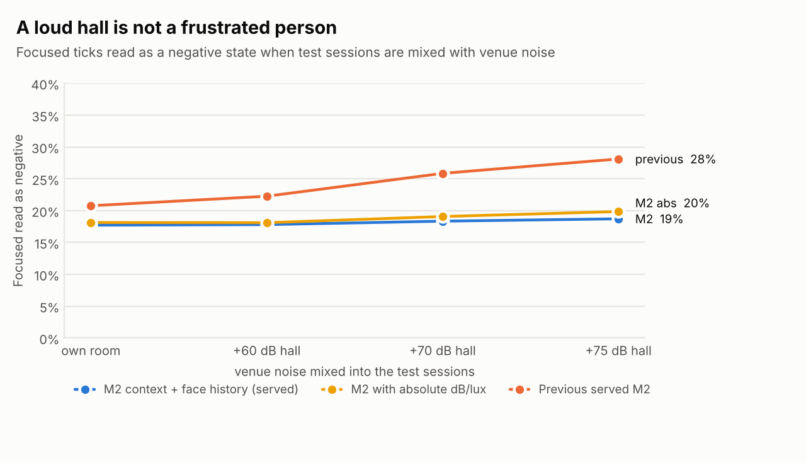

# Results

> Generated by `scripts/write_results.py` from `reports/metrics.json` (2026-10-18 15:38:46). Do not edit by hand; rerun `make eval` then the script.

**All numbers are on simulated data** (45 held-out simulator sessions, `noise_scale` 1.0, untuned). They test the architecture under the behavioral assumptions published in [DATASET.md](DATASET.md) — not real-world accuracy. Session-level bootstrap: 200 resamples.

## Headline

| Claim | Face-only (M0) | Served (M2) |
|---|---|---|
| Masked frustration caught (Frustrated_Masked recall) | 11.2% | 68.0% |
| Focused people misread as a negative state ("resting focus face") | 56.3% | 17.9% |
| Macro-F1, full 15-minute window | 0.422 | 0.797 |
| Macro-F1 with the face hidden on every tick | 0.121 | 0.678 |
| Macro-F1 at 10% light (face readings degraded) | 0.252 | 0.679 |

Calibration (M2, temperature 0.93): expected calibration error 0.013 before, 0.004 after temperature scaling.

## Proof 2 — context over time beats a face snapshot

| Model | 0 min | 1 min | 2 min | 5 min | 10 min | 15 min |
|---|---|---|---|---|---|---|
| M0 face snapshot | 0.418 [0.40, 0.43] | 0.418 [0.40, 0.43] | 0.417 [0.40, 0.43] | 0.417 [0.40, 0.43] | 0.419 [0.40, 0.43] | 0.419 [0.40, 0.44] |
| M0t face history | 0.363 [0.34, 0.38] | 0.470 [0.45, 0.49] | 0.485 [0.46, 0.51] | 0.485 [0.46, 0.51] | 0.491 [0.47, 0.51] | 0.489 [0.47, 0.51] |
| M1 context snapshot | 0.584 [0.57, 0.60] | 0.584 [0.57, 0.60] | 0.583 [0.57, 0.60] | 0.583 [0.57, 0.60] | 0.582 [0.56, 0.60] | 0.583 [0.57, 0.60] |
| M2 context history, no face | 0.554 [0.54, 0.57] | 0.635 [0.62, 0.66] | 0.661 [0.65, 0.68] | 0.675 [0.66, 0.69] | 0.673 [0.65, 0.69] | 0.668 [0.65, 0.69] |
| **M2 served (context + face history)** | 0.649 [0.63, 0.67] | 0.746 [0.73, 0.77] | 0.777 [0.76, 0.79] | 0.791 [0.78, 0.81] | 0.789 [0.77, 0.81] | 0.784 [0.77, 0.80] |
| M3 GRU + attention (benchmark) | 0.615 | 0.733 | 0.760 | 0.770 | 0.763 | 0.709 |

Macro-F1 by minutes of history in the rolling window (95% CI in brackets). The face-only model is flat by construction; the context models gain from the window.

### Full model ladder (full 15-minute window)

| Model | Macro-F1 | Balanced accuracy | Recall Focused | Recall Frustrated_Masked | Recall Exhausted | Recall Collaborative_Happy |
|---|---|---|---|---|---|---|
| M0 face snapshot | 0.422 | 0.444 | 42.8% | 11.2% | 60.1% | 63.5% |
| M0t face history | 0.490 | 0.517 | 49.0% | 18.1% | 61.2% | 78.6% |
| M1 context snapshot | 0.583 | 0.585 | 57.8% | 47.8% | 72.2% | 56.0% |
| M2 context history, no face | 0.677 | 0.678 | 65.2% | 63.1% | 77.0% | 66.0% |
| M2 with absolute dB/lux (ablation) | 0.794 | 0.796 | 80.3% | 67.8% | 85.2% | 85.2% |
| M2 without the Time layer | 0.784 | 0.786 | 77.4% | 67.2% | 84.8% | 85.2% |
| **M2 served (context + face history)** | 0.797 | 0.799 | 80.9% | 68.0% | 85.0% | 85.8% |

M3 (GRU + attention over raw ticks, trained on cpu): macro-F1 0.759 on mixed-history test windows. Benchmark only; M2 is served because its TreeSHAP attributions drive the explanations. Its curve peaks before the full window and then drops, which suggests it is under-trained on long sequences within the training budget; treat it as a lower bound.

### Where context is weak: the first minute of a new episode

| Time since the episode began | Windows | M0 | M1 | M2 |
|---|---|---|---|---|
| 0-30 s | 1663 | 44.3% | 19.5% | 32.8% |
| 30-60 s | 1971 | 42.8% | 26.5% | 49.1% |
| 1-2 min | 3887 | 44.3% | 40.0% | 67.5% |
| 2-5 min | 9179 | 44.6% | 64.2% | 86.0% |
| 5+ min | 9795 | 46.1% | 76.8% | 94.0% |

Context lags behavior: in the first 30 seconds of a new emotional episode the served model is less accurate than the face alone. This is the honest cost of a context model, and why the override and label changes use hysteresis.

## Proof 3 — stable when face evidence is missing or degraded

Only the face channel is degraded; every context channel (including the lux feature) is unchanged.

| Share of ticks with the face hidden | M0 face snapshot | M0t face history | M2 context history, no face | M2 served (context + face history) |
|---|---|---|---|---|
| 0% | 0.431 | 0.495 | 0.679 | 0.796 |
| 25% | 0.386 | 0.469 | 0.679 | 0.789 |
| 50% | 0.322 | 0.457 | 0.679 | 0.781 |
| 75% | 0.245 | 0.415 | 0.679 | 0.768 |
| 100% | 0.121 | 0.082 | 0.679 | 0.678 |

| Relative light level | M0 face snapshot | M0t face history | M2 context history, no face | M2 served (context + face history) |
|---|---|---|---|---|
| 1 | 0.431 | 0.495 | 0.679 | 0.796 |
| 0.5 | 0.377 | 0.454 | 0.679 | 0.767 |
| 0.25 | 0.309 | 0.345 | 0.679 | 0.723 |
| 0.1 | 0.252 | 0.292 | 0.679 | 0.679 |

Scope of this claim: decision stability when face evidence is missing or degraded. It is not a measurement of demographic bias; the upstream face and pose detectors' fairness evaluations are in their own model cards (see [MODEL_CARD.md](MODEL_CARD.md)).

## Why the original mock dataset was replaced

| Trained on the original mock data (i.i.d. rows) | Accuracy |
|---|---|
| Face column only | 66.7% |
| Context columns only | 100.0% |
| All columns | 100.0% |

Context alone was perfectly separable and rows had no time structure, so the original data could not test the 15-minute window. Simulator v2 adds time structure, overlap, noise and missing modalities ([DATASET.md](DATASET.md)).

## Venue shift: a loud hall is not a frustrated person

Focused ticks read as a negative state when the test sessions are mixed with constant hall noise (0 = the session's own room). The served model reads the room relative to the venue baseline captured on arrival (`POST /api/room/baseline`).

| Model | own room | +60 dB hall | +70 dB hall | +75 dB hall |
|---|---|---|---|---|
| M2 served (room-relative) | 17.7% | 17.8% | 18.4% | 18.7% |
| M2 with absolute dB/lux | 18.1% | 18.1% | 19.1% | 19.9% |
| Previous served M2 | 20.8% | 22.3% | 25.9% | 28.1% |

## Ablations

- With absolute dB/lux instead of room-relative levels: macro-F1 0.794 vs 0.797 on the simulator's own rooms; see the venue shift above for what absolute levels cost in a loud hall.
- Without the Time layer (hours since break, time of day): 0.784 — an operator-set break clock is not what drives the label.

All results are on simulator data generated under the published behavioral assumptions in docs/DATASET.md; they test the architecture, not real-world accuracy.
