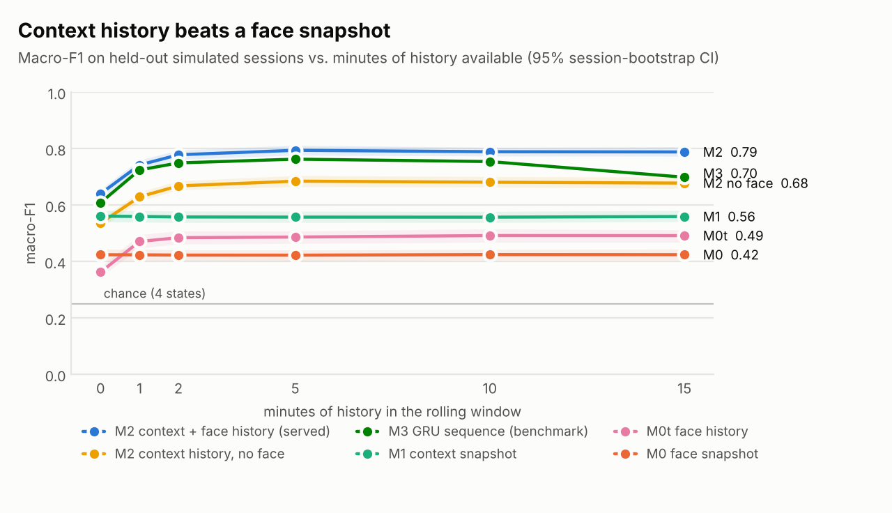
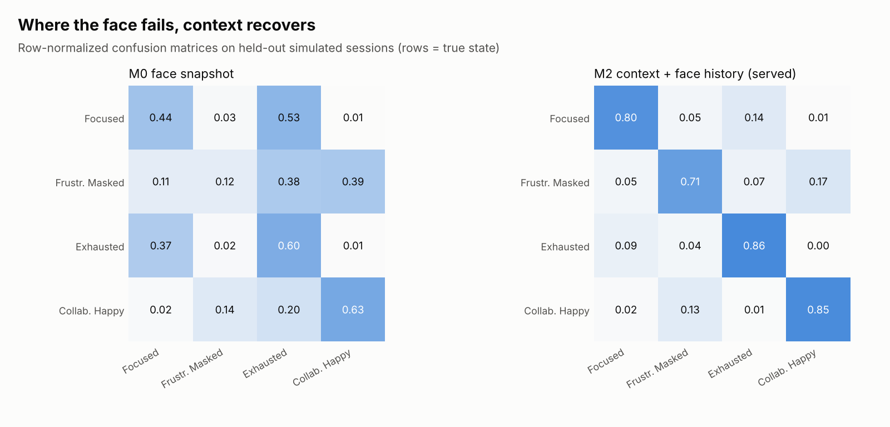
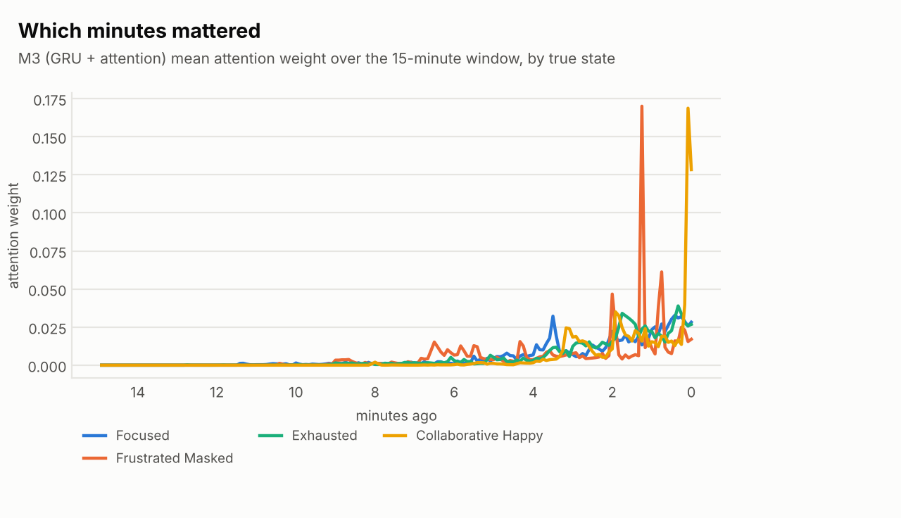
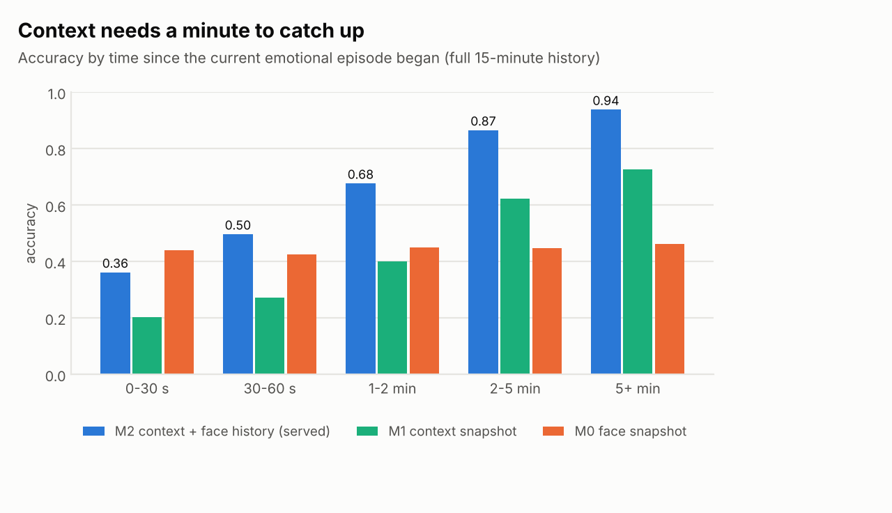
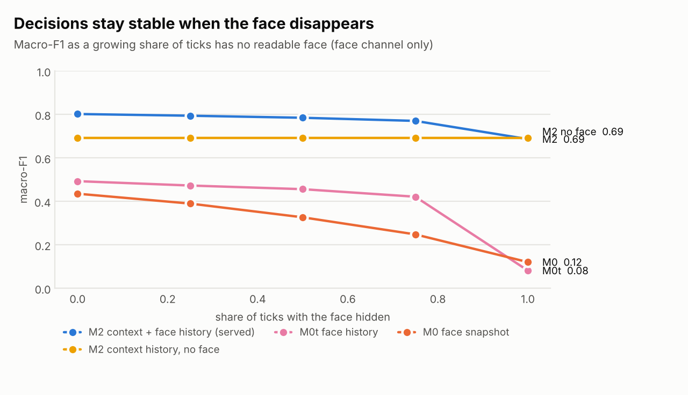
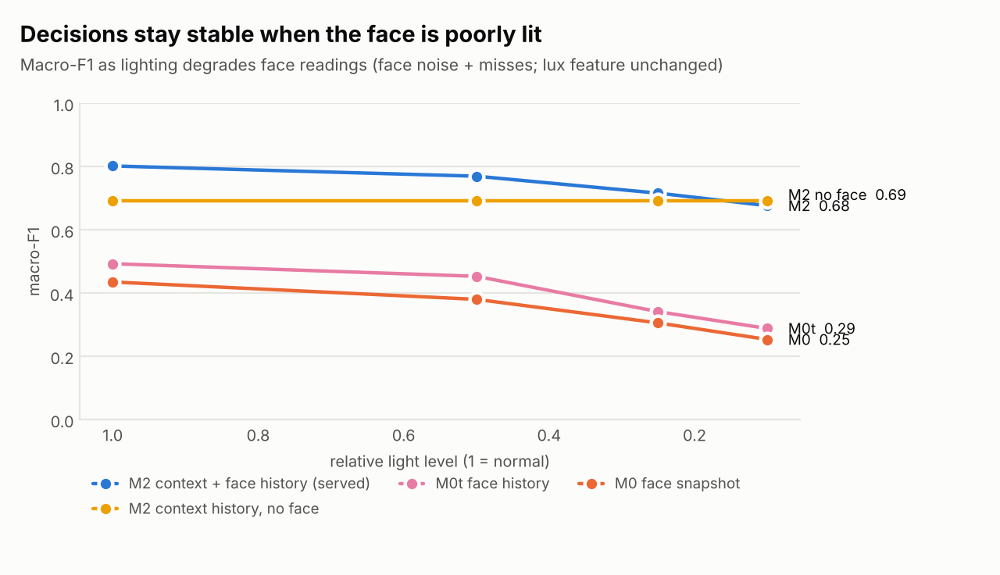

# Results

> Generated by `scripts/write_results.py` from `reports/metrics.json` (2026-10-18 00:33:13). Do not edit by hand; rerun `make eval` then the script.

**All numbers are on simulated data** (45 held-out simulator sessions, `noise_scale` 1.0, untuned). They test the architecture under the behavioral assumptions published in [DATASET.md](DATASET.md) — not real-world accuracy. Session-level bootstrap: 200 resamples.

## Headline

| Claim | Face-only (M0) | Served (M2) |
|---|---|---|
| Masked frustration caught (Frustrated_Masked recall) | 11.7% | 70.8% |
| Focused people misread as a negative state ("resting focus face") | 55.9% | 18.8% |
| Macro-F1, full 15-minute window | 0.425 | 0.802 |
| Macro-F1 with the face hidden on every tick | 0.121 | 0.687 |
| Macro-F1 at 10% light (face readings degraded) | 0.254 | 0.677 |

Calibration (M2, temperature 0.95): expected calibration error 0.008 before, 0.006 after temperature scaling.

## Proof 2 — context over time beats a face snapshot

| Model | 0 min | 1 min | 2 min | 5 min | 10 min | 15 min |
|---|---|---|---|---|---|---|
| M0 face snapshot | 0.424 [0.41, 0.44] | 0.424 [0.41, 0.44] | 0.423 [0.40, 0.44] | 0.423 [0.40, 0.44] | 0.425 [0.41, 0.44] | 0.425 [0.41, 0.44] |
| M0t face history | 0.363 [0.35, 0.38] | 0.471 [0.45, 0.50] | 0.485 [0.46, 0.51] | 0.487 [0.46, 0.51] | 0.492 [0.47, 0.52] | 0.492 [0.47, 0.51] |
| M1 context snapshot | 0.561 [0.54, 0.58] | 0.560 [0.54, 0.58] | 0.558 [0.54, 0.58] | 0.558 [0.54, 0.58] | 0.558 [0.54, 0.58] | 0.560 [0.54, 0.58] |
| M2 context history, no face | 0.536 [0.52, 0.55] | 0.630 [0.61, 0.65] | 0.668 [0.66, 0.69] | 0.685 [0.67, 0.71] | 0.681 [0.66, 0.70] | 0.678 [0.66, 0.70] |
| **M2 served (context + face history)** | 0.641 [0.62, 0.66] | 0.743 [0.72, 0.76] | 0.779 [0.76, 0.79] | 0.794 [0.78, 0.81] | 0.790 [0.77, 0.80] | 0.789 [0.77, 0.81] |
| M3 GRU + attention (benchmark) | 0.609 | 0.725 | 0.750 | 0.763 | 0.755 | 0.699 |

Macro-F1 by minutes of history in the rolling window (95% CI in brackets). The face-only model is flat by construction; the context models gain from the window.

### Full model ladder (full 15-minute window)

| Model | Macro-F1 | Balanced accuracy | Recall Focused | Recall Frustrated_Masked | Recall Exhausted | Recall Collaborative_Happy |
|---|---|---|---|---|---|---|
| M0 face snapshot | 0.425 | 0.446 | 43.6% | 11.7% | 59.9% | 63.4% |
| M0t face history | 0.491 | 0.518 | 49.6% | 18.1% | 61.1% | 78.4% |
| M1 context snapshot | 0.563 | 0.565 | 56.8% | 44.3% | 69.5% | 55.4% |
| M2 context history, no face | 0.694 | 0.696 | 66.5% | 67.4% | 78.0% | 66.4% |
| M2 without absolute dB | 0.799 | 0.801 | 80.7% | 70.1% | 85.2% | 84.3% |
| M2 without the Time layer | 0.786 | 0.788 | 78.0% | 68.7% | 84.3% | 84.1% |
| **M2 served (context + face history)** | 0.802 | 0.803 | 80.1% | 70.8% | 85.8% | 84.5% |

M3 (GRU + attention over raw ticks, trained on cpu): macro-F1 0.753 on mixed-history test windows. Benchmark only; M2 is served because its TreeSHAP attributions drive the explanations. Its curve peaks before the full window and then drops, which suggests it is under-trained on long sequences within the training budget; treat it as a lower bound.

### Where context is weak: the first minute of a new episode

| Time since the episode began | Windows | M0 | M1 | M2 |
|---|---|---|---|---|
| 0-30 s | 1663 | 44.0% | 20.4% | 36.2% |
| 30-60 s | 1971 | 42.6% | 27.1% | 49.7% |
| 1-2 min | 3887 | 44.9% | 40.2% | 67.7% |
| 2-5 min | 9179 | 44.8% | 62.2% | 86.6% |
| 5+ min | 9795 | 46.3% | 72.7% | 93.8% |

Context lags behavior: in the first 30 seconds of a new emotional episode the served model is less accurate than the face alone. This is the honest cost of a context model, and why the override and label changes use hysteresis.

## Proof 3 — stable when face evidence is missing or degraded

Only the face channel is degraded; every context channel (including the lux feature) is unchanged.

| Share of ticks with the face hidden | M0 face snapshot | M0t face history | M2 context history, no face | M2 served (context + face history) |
|---|---|---|---|---|
| 0% | 0.436 | 0.493 | 0.693 | 0.802 |
| 25% | 0.390 | 0.473 | 0.693 | 0.795 |
| 50% | 0.327 | 0.457 | 0.693 | 0.785 |
| 75% | 0.248 | 0.422 | 0.693 | 0.771 |
| 100% | 0.121 | 0.082 | 0.693 | 0.687 |

| Relative light level | M0 face snapshot | M0t face history | M2 context history, no face | M2 served (context + face history) |
|---|---|---|---|---|
| 1 | 0.436 | 0.493 | 0.693 | 0.802 |
| 0.5 | 0.381 | 0.454 | 0.693 | 0.770 |
| 0.25 | 0.306 | 0.342 | 0.693 | 0.717 |
| 0.1 | 0.254 | 0.289 | 0.693 | 0.677 |

Scope of this claim: decision stability when face evidence is missing or degraded. It is not a measurement of demographic bias; the upstream face and pose detectors' fairness evaluations are in their own model cards (see [MODEL_CARD.md](MODEL_CARD.md)).

## Why the original mock dataset was replaced

| Trained on the original mock data (i.i.d. rows) | Accuracy |
|---|---|
| Face column only | 66.7% |
| Context columns only | 100.0% |
| All columns | 100.0% |

Context alone was perfectly separable and rows had no time structure, so the original data could not test the 15-minute window. Simulator v2 adds time structure, overlap, noise and missing modalities ([DATASET.md](DATASET.md)).

## Ablations

- Without absolute dB features: macro-F1 0.799 vs 0.802 — robust to microphone and room level differences.
- Without the Time layer (hours since break, time of day): 0.786 — an operator-set break clock is not what drives the label.

All results are on simulator data generated under the published behavioral assumptions in docs/DATASET.md; they test the architecture, not real-world accuracy.
